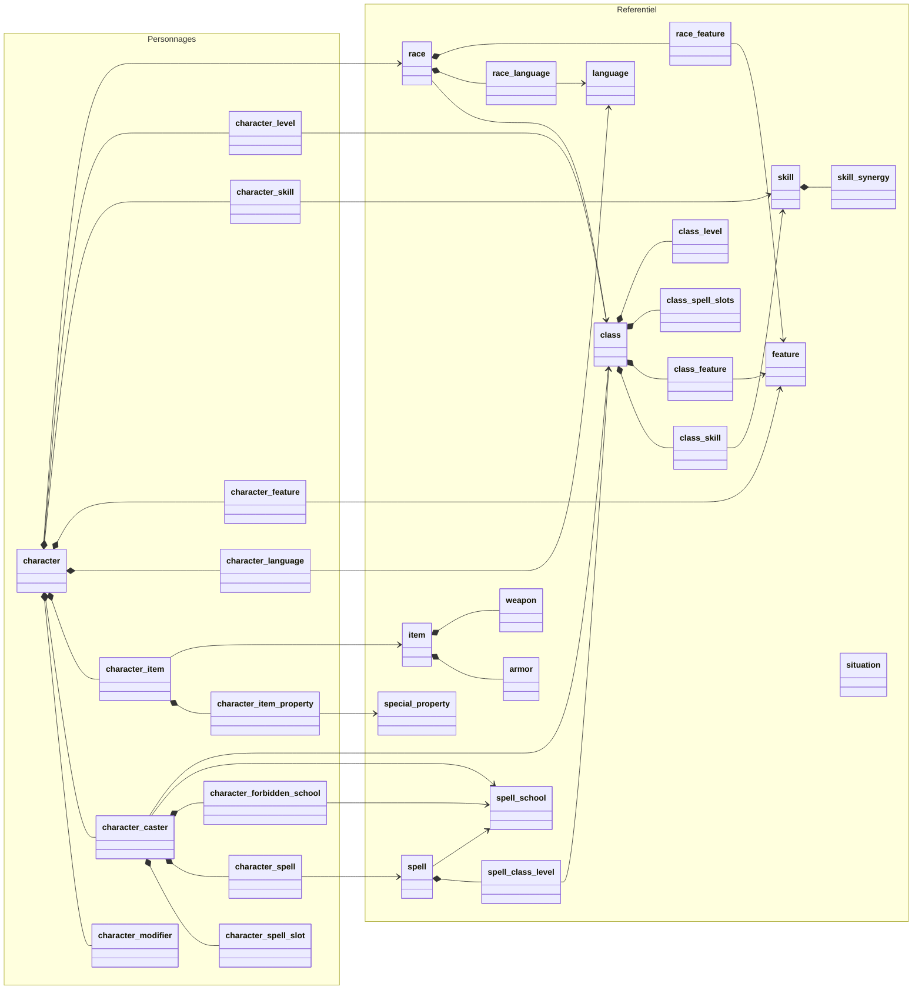
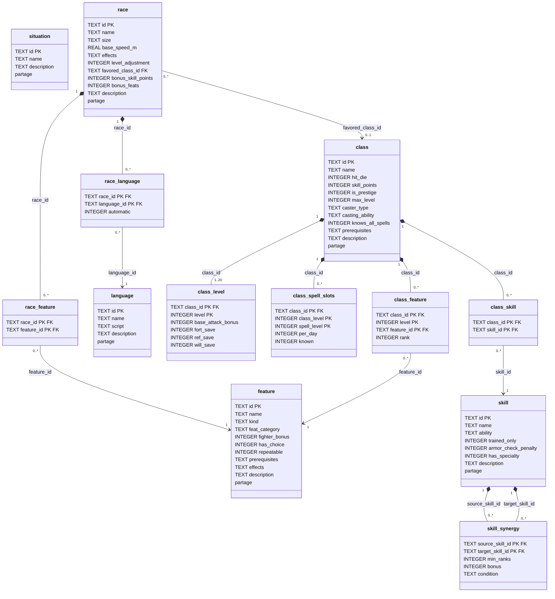
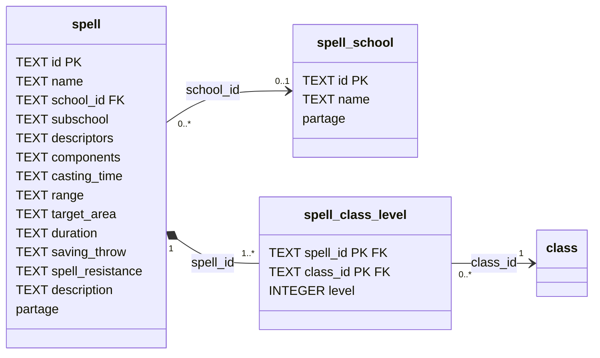
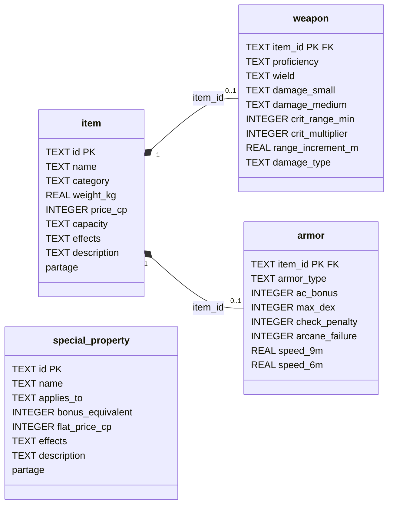
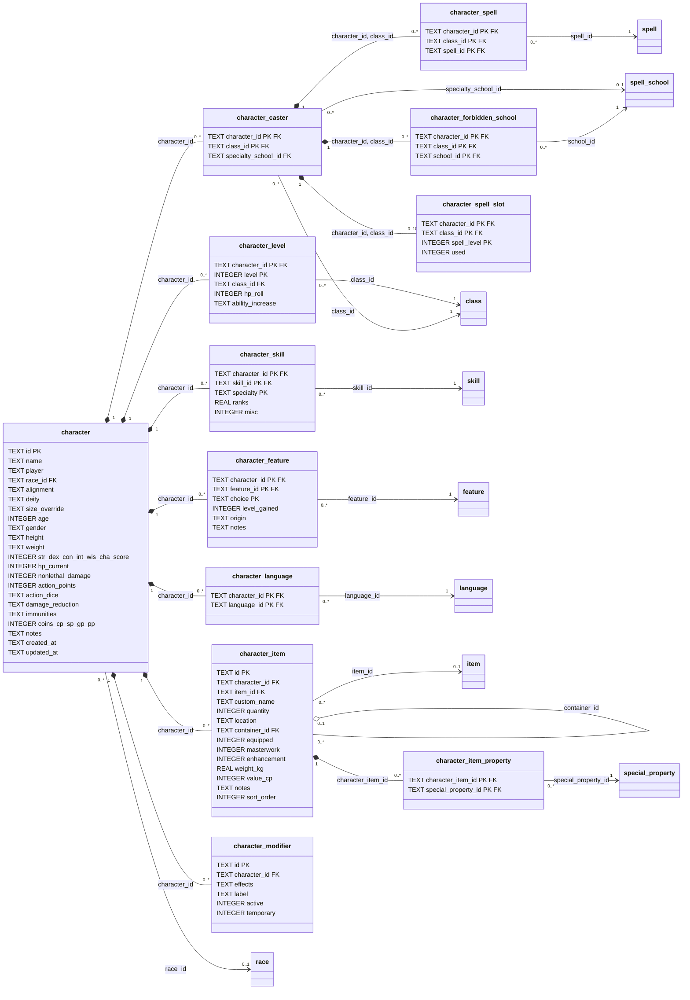
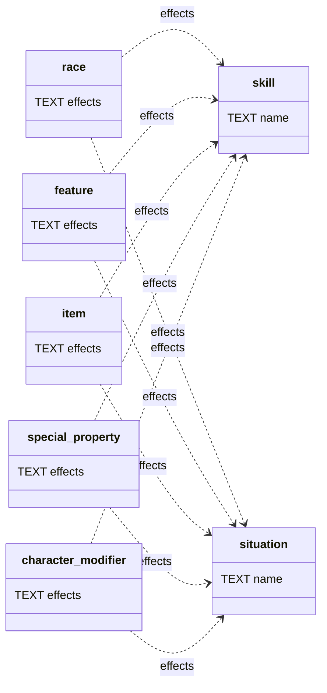

# Diagramme de classes du schéma

Une classe par table de `schema.sql` (33 tables). Les diagrammes sont en
[Mermaid](https://mermaid.js.org/) : ils s'affichent sur GitHub, dans VS Code avec
l'extension « Markdown Preview Mermaid Support », ou en collant un bloc sur
<https://mermaid.live>.

## Lire les flèches

| Trait | Sens | En SQL |
|---|---|---|
| `A *-- B` (losange plein) | B appartient à A et disparaît avec lui | clé étrangère `ON DELETE CASCADE` |
| `A o-- B` (losange vide) | B est rangé dans A, mais lui survit | clé étrangère `ON DELETE SET NULL` |
| `A --> B` (flèche pleine) | A fait référence à B ; B ne peut pas être supprimé tant qu'il est utilisé | clé étrangère simple |
| `A ..> B` (pointillés) | A cite B par son nom dans sa colonne `effects` | **aucune** clé étrangère (voir `EFFETS.md`) |

L'étiquette d'un lien est la colonne qui porte la clé étrangère. Dans les diagrammes
détaillés, `PK` marque la clé primaire et `FK` une clé étrangère.

Les classes ont le nom de leur table, sauf `class`, qui est un mot réservé de Mermaid :
elle s'appelle `classe` dans le code des diagrammes, mais s'affiche `class`.

`schema_info` (version du schéma, du slug et du langage des effets, espace de noms des
ids) n'a aucun lien : elle n'apparaît pas dans les diagrammes.

Les colonnes de partage `source`, `author`, `updated_at` et `content_hash`, présentes dans
toutes les tables à id du référentiel, sont résumées par la ligne `partage`.

---

## 1. Vue d'ensemble

Toutes les tables et toutes les clés étrangères, sans les colonnes. À gauche le
référentiel partagé (ids UUID v5, identiques chez tous les joueurs), à droite les
personnages (ids UUID v4, propres à chaque joueur).

Ce qu'il faut en retenir :

- **Les flèches vont toujours des personnages vers le référentiel, jamais l'inverse.**
  On peut donc échanger le référentiel sans rien savoir des personnages, et un personnage
  exporté doit emmener (ou trouver chez le destinataire) les éléments du référentiel
  qu'il cite.
- **Supprimer un personnage supprime tout ce qui lui appartient** (losanges pleins),
  mais rien dans le référentiel.
- **Un élément du référentiel utilisé par un personnage ne peut pas être supprimé**
  (flèches pleines sans cascade) : SQLite refuse, tant que `PRAGMA foreign_keys = ON`.
- **`situation` reste isolée** : aucune clé étrangère ne la vise, elle n'est citée que
  dans les textes `effects` (section 6). `special_property` n'est visée que par
  `character_item_property`.

---

## 2. Règles : compétences, situations, capacités, races, classes

`feature` regroupe les dons, les aptitudes de classe et les traits raciaux (`kind`). Une
race les reçoit par `race_feature`, une classe par `class_feature` (avec le niveau et le
rang), un personnage par `character_feature` (section 5).

---

## 3. Magie

Un sort n'a pas le même niveau selon la classe : c'est `spell_class_level` qui le porte,
pas `spell`.

---

## 4. Objets

`weapon` et `armor` sont des **extensions** de `item` (relation 1-1, même clé) : une épée
longue a une ligne dans `item` et une dans `weapon`. `special_property` n'est reliée à
aucun objet du référentiel : c'est l'objet **porté par un personnage** qui reçoit ses
propriétés (`character_item_property`, section 5).

---

## 5. Personnages

Les tables du référentiel apparaissent sans leurs colonnes, détaillées plus haut.

Points de lecture :

- **Les six caractéristiques sont des colonnes de `character`** (`str_score` …
  `cha_score`), résumées ici en une ligne. La « valeur temporaire » de la fiche n'est pas
  stockée : c'est la valeur de base plus les `character_modifier` actifs.
- **`character_caster` est un intermédiaire** : les sorts connus, les emplacements
  utilisés et les écoles interdites d'un personnage dépendent de la classe qui les lance
  (un prêtre-magicien a deux listes). Leur clé étrangère est composée,
  `(character_id, class_id)`.
- **Personne ne prépare ses sorts** (règle maison). `character_spell` ne dit que « ce sort
  est connu » ; `character_spell_slot` compte les emplacements utilisés par niveau de
  sort depuis le dernier repos. Le nombre d'emplacements, lui, se calcule. Une classe à
  `knows_all_spells = 1` (prêtre, druide) n'a pas de ligne dans `character_spell` : elle
  connaît toute sa liste.
- **`character_item` se contient lui-même** : `container_id` range un objet dans un sac.
  Supprimer le sac ne supprime pas son contenu, qui se retrouve hors de tout récipient
  (`SET NULL`).
- **`character_item.item_id` est facultatif** : un objet peut être saisi librement, sans
  entrée dans le référentiel (`custom_name`).

`coins_cp_sp_gp_pp` résume les quatre colonnes `coins_cp`, `coins_sp`, `coins_gp` et
`coins_pp`.

---

## 6. Les effets : des liens sans clé étrangère

Cinq tables ont une colonne `effects`, écrite dans le langage décrit par `EFFETS.md`. Ces
textes citent des compétences et des situations **par leur nom**, pas par leur id : SQLite
ne peut pas vérifier ces liens, c'est l'analyseur Rust qui le fait, à chaque saisie et à
chaque import.

Conséquences :

- une compétence citée doit exister : sinon l'effet est refusé (`CIBLE_INCONNUE`) ;
- une situation citée peut ne pas exister : elle devient une situation libre ;
- supprimer ou renommer une compétence ou une situation ne prévient pas SQLite : c'est
  l'application qui doit remettre en forme les textes qui la citent (`EFFETS.md`, 7.3) ;
- à l'import, compétences et situations passent avant les tables qui les citent
  (`EFFETS.md`, section 9).
